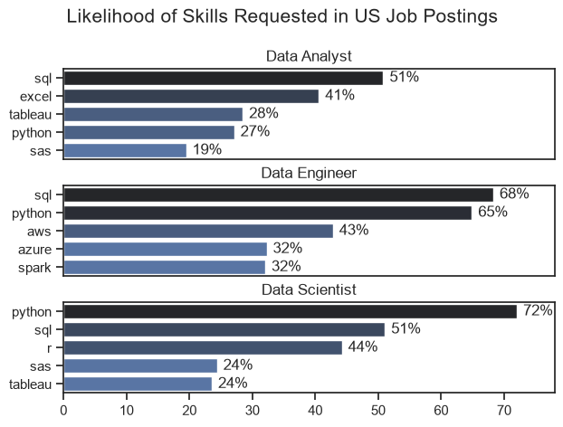
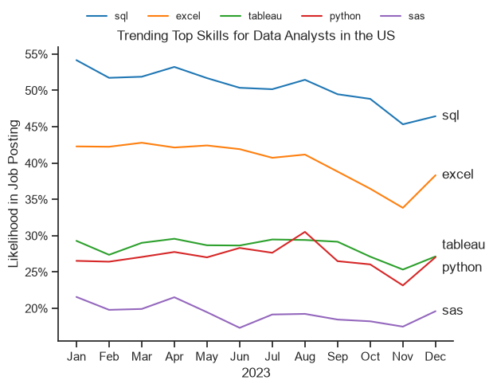
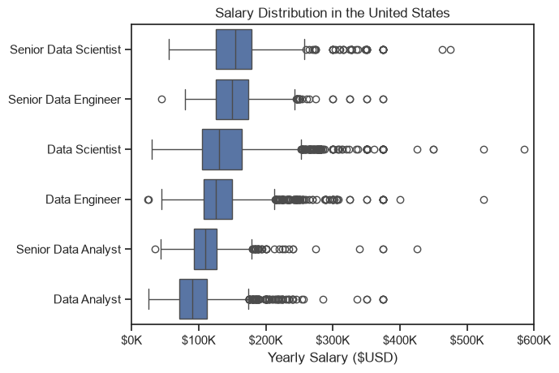
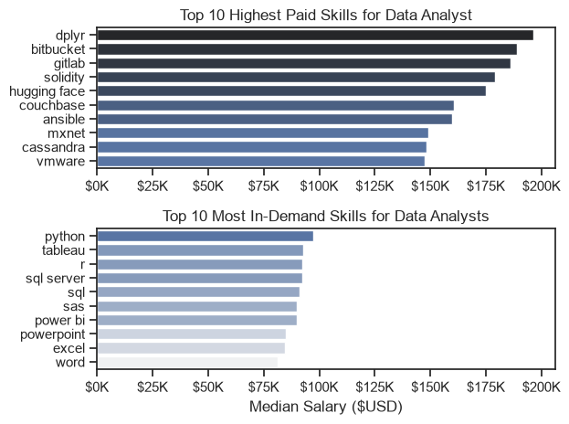
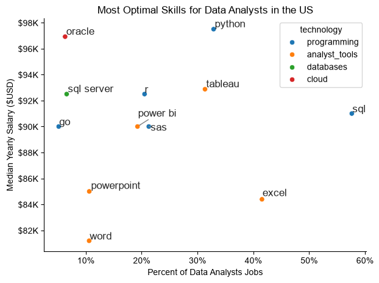

## 📌 Project Overview

This project explores the **US Data Job Market**, focusing primarily on Data Analyst roles. My goal is to identify the most in-demand and highest-paying skills, understand salary trends, and determine which technical skills offer the best career opportunities.

The analysis uses a dataset provided through **Luke Barousse's Python course**, containing information about job titles, salaries, locations, and required skills.

### ❓ Questions I Aim to Answer

1. What are the most in-demand skills across Data Analyst, Data Engineer, and Data Scientist roles?
2. How did skill demand for Data Analysts change throughout 2023?
3. How do salaries vary across data roles and technical skills?
4. Which skills offer the best combination of **high demand and competitive salaries**?

### 🛠️ Tools & Technologies

- **Python:** Main programming language for data analysis.
- **Pandas:** Data cleaning, filtering, grouping, and aggregation.
- **Matplotlib & Seaborn:** Data visualization and statistical charts.
- **Jupyter Notebooks:** Interactive coding, analysis, and documentation.
- **VS Code:** Development environment.
- **Git & GitHub:** Version control and project sharing.

### 🧹 Data Preparation & Cleaning

Before conducting the analysis, I prepared the dataset by:

- Importing and exploring the job postings data.
- Converting date columns into appropriate datetime formats.
- Transforming skill lists into usable Python objects.
- Handling missing salary values where necessary.
- Filtering data by job title, country, and relevant skills.
- Using Pandas operations to aggregate and prepare data for visualization.

# The Analysis
## 1. What are the most demanded skills for the top 3 most popular data roles?

To find the most demanded skills for the top 3 most popular data roles. I filtered out those positions by which ones were the most popular, and got the top 5 skills for these top 3 roles. This query highlights the most popular job titles and ther top skills, showing which skills I should pay attention to depending on the role I'm targeting. 

View my notebook with detailed steps here:
[2_Skill_Demand.ipynb](3_Project/2_Skill_Demand.ipynb)

```python
fig, ax = plt.subplots(len(job_titles), 1)

sns.set_theme(style='ticks')
for i, job_title in enumerate(job_titles):
    df_plot = df_skills_percent[df_skills_percent['job_title_short'] == job_title].head()
    sns.barplot(data=df_plot, x='skill_percent', y='job_skills', ax=ax[i], hue='skill_count', palette='dark:b_r')
    ax[i].set_title(job_title)
    ax[i].set_xlabel('')
    ax[i].set_ylabel('')
    ax[i].get_legend().remove()
    ax[i].set_xlim(0,78)

    for n, v in enumerate(df_plot['skill_percent']):
        ax[i].text(v+1, n, f'{v:.0f}%', va='center')

    if i != len(job_titles) - 1:
        ax[i].set_xticks([])

fig.suptitle('Likelihood of Skills Requested in US Job Postings', fontsize=15)
plt.tight_layout(h_pad=0.5)
plt.show()
```
### Results



## 📊 Key Insights: Most In-Demand Skills in US Data Jobs

This analysis compares the five most frequently requested skills in US job postings for **Data Analysts, Data Engineers, and Data Scientists**.

### 🔍 1. SQL Is Essential Across All Three Roles
- SQL appears in **68% of Data Engineer postings** and **51% of both Data Analyst and Data Scientist postings**.
- This highlights SQL's importance across the data industry, particularly for querying, managing, and transforming data.

### 🐍 2. Python Dominates Data Science and Data Engineering
- Python is requested in **72% of Data Scientist postings**, making it the most frequently requested skill for this role.
- It also appears in **65% of Data Engineer postings**, compared with **27% of Data Analyst postings**.
- Python is particularly valuable for careers involving advanced analytics, data engineering, and machine learning.

### 📈 3. Data Analysts Focus on SQL, Excel, and Visualization
- The most requested Data Analyst skills are **SQL (51%), Excel (41%), and Tableau (28%)**.
- Python follows closely at 27%.
- These findings suggest that Data Analyst positions emphasize extracting, manipulating, analyzing, and presenting business data.

### ☁️ 4. Data Engineering Requires Cloud and Technical Expertise
- Beyond SQL (68%) and Python (65%), Data Engineer postings frequently request **AWS (43%), Azure (32%), and Spark (32%)**.
- Cloud platforms and distributed data processing are important components of the Data Engineer skill set.
- Compared with the other two roles, Data Engineering shows a stronger emphasis on infrastructure and data processing technologies.

### 🧠 5. Data Science Emphasizes Statistical Programming
- Python leads Data Scientist requirements at **72%**, followed by SQL (51%) and R (44%).
- The high demand for R highlights the importance of statistical programming alongside Python.
- SAS and Tableau each appear in **24%** of Data Scientist postings.

### 🎯 6. Each Data Career Has a Distinct Skill Set
- **📊 Data Analysts:** SQL, Excel, and visualization tools dominate the top requested skills.
- **⚙️ Data Engineers:** SQL, Python, cloud technologies, and Spark are prominent.
- **🔬 Data Scientists:** Python, SQL, and R are the leading requirements.

Although all three careers share foundational technical skills, each requires a different area of specialization.

---

### 💡 Overall Conclusion

**SQL and Python stand out as highly transferable skills across data careers.** However, the most valuable additional skills depend on the target role.

- **Aspiring Data Analysts:** Prioritize SQL, Excel, and visualization tools.
- **Aspiring Data Engineers:** Focus on Python, SQL, and cloud technologies.
- **Aspiring Data Scientists:** Develop Python, SQL, and statistical programming skills.

📌 **Note:** Percentages represent the proportion of analyzed US job postings mentioning each skill within its respective job category. A job posting may request multiple skills, and only the five most frequently requested skills per role are displayed.

# The Analysis

## 2. How are in-demand skills trending for Data Analysts

### Visualize Data

``` python
from matplotlib.ticker import PercentFormatter

df_plot = df_DA_US_percent.iloc[:, :5]
sns.lineplot(data = df_plot, dashes=False, palette='tab10')

ax = plt.gca()
ax.yaxis.set_major_formatter(PercentFormatter(decimals=0))

for i in range(5):
    y = df_plot.iloc[-1, i]

    if df_plot.columns[i] == 'python':
        y -= 1.5  # Move Python down

    elif df_plot.columns[i] == 'tableau':
        y += 1.5  # Move Tableau up

    plt.text(11.2, y, df_plot.columns[i], va='center')
```

### Results



## 📈 Key Insights: Trends in Data Analyst Skills (2023)

This analysis examines how frequently the top five technical skills appeared in US Data Analyst job postings throughout 2023.

### 🥇 1. SQL Remained the Most In-Demand Skill
- SQL consistently ranked as the most requested skill throughout the year.
- Demand started at approximately **54% in January** and declined to around **47% in December**.
- Despite the decline, SQL maintained a significant lead over the other skills.

**💡 Insight:** SQL remained a foundational skill for Data Analysts, even as its share of job postings gradually decreased.

### 📊 2. Excel Maintained Strong Demand
- Excel consistently ranked second, appearing in approximately **42% of postings** at the beginning of the year.
- Demand declined during the final quarter, reaching roughly **34% in November**, before recovering to **38% in December**.
- Excel remained one of the most frequently requested skills throughout 2023.

**💡 Insight:** Traditional spreadsheet skills continued to play an important role in Data Analyst positions alongside programming and visualization tools.

### 🐍 3. Python Showed Fluctuating Demand
- Python appeared in approximately **26–27% of postings** at the beginning of 2023.
- Demand peaked at around **30% in August**, temporarily exceeding Tableau.
- It then declined to approximately **23% in November**, before recovering to **27% in December**.

**💡 Insight:** Python remained relevant for Data Analysts, although its monthly demand fluctuated more noticeably than some other skills.

### 📉 4. Tableau Demand Was Relatively Stable
- Tableau generally appeared in **27–30% of job postings** during most of the year.
- Its highest values were close to 30%, while its lowest point occurred in November at approximately 25%.
- By December, Tableau and Python had converged at roughly 27%.

**💡 Insight:** Data visualization remained a consistent requirement, with Tableau maintaining a relatively steady presence in job postings.

### 📌 5. SAS Had the Lowest Demand Among the Top Five
- SAS appeared in approximately **17–22% of postings** throughout the year.
- Its share remained below the other four skills.
- Despite monthly fluctuations, it continued to appear in a meaningful proportion of job postings.

**💡 Insight:** SAS remained relevant in the analyzed market, although it was less frequently requested than SQL, Excel, Tableau, and Python.

### 🔎 6. Most Skills Experienced a Decline Toward Year-End
- SQL, Excel, Tableau, and SAS generally ended the year below their January levels.
- November showed a noticeable decline across several skills.
- Most skills experienced some recovery in December.

**💡 Insight:** Skill requirements were not constant throughout the year. However, these fluctuations alone do not establish whether overall hiring demand increased or decreased.

---

### 🎯 Overall Conclusion

The analysis highlights three important findings:

1. **SQL and Excel remained dominant**, demonstrating the continued importance of database querying and spreadsheet analysis.
2. **Python and Tableau competed closely**, showing the relevance of both programming and data visualization skills.
3. **Skill requirements fluctuated over time**, but the overall ranking of the most requested skills remained relatively consistent.

**🚀 Career Takeaway:** For aspiring Data Analysts, developing strong SQL and Excel skills provides a relevant foundation, while Python and Tableau offer complementary capabilities for more advanced analysis and visualization.

*📌 Note: Percentages represent the share of analyzed US Data Analyst job postings mentioning each skill in a given month. Multiple skills may appear in the same posting. These results describe the 2023 dataset and should not be interpreted as current market demand or future hiring forecasts.*

# The Analysis

## 3. How well do jobs and skills pay for Data Analysts?

### Salary Analysis for Data Nerds

```python
sns.boxplot(data=df_US_top6, x='salary_year_avg', y='job_title_short', order=job_order)
sns.set_theme(style='ticks')

plt.title('Salary Distribution in the United States')
plt.xlabel('Yearly Salary ($USD)')
plt.ylabel('')
plt.xlim(0, 600000)
ticks_x = plt.FuncFormatter(lambda y, pos: f'${int(y/1000)}K')
plt.gca().xaxis.set_major_formatter(ticks_x)
plt.show()
```

#### Results

*Box plot visualizing the salary distributions for the top 6 data job titles.*

## 💰 Key Insights: Salary Distribution Across Data Careers in the US

This analysis compares annual salary distributions for six data-related job titles in the United States, using boxplots to examine **median salaries, salary variability, and outliers**.

### 🥇 1. Senior Data Scientists Have the Highest Median Salaries
- Senior Data Scientists have the highest median salary, approximately **$155K**, closely followed by Senior Data Engineers at around **$150K**.
- Data Scientists and Data Engineers follow, with median salaries around **$130K**.
- Data Analysts have the lowest median salary, approximately **$90K**.

**💡 Insight:** More specialized and senior-level positions generally offer higher typical compensation than Data Analyst roles.

### 📈 2. Seniority Is Associated With Higher Salaries
- Senior Data Analysts earn a median of approximately **$110K**, compared with **$90K** for Data Analysts.
- Senior Data Engineers have a higher median salary than Data Engineers.
- Senior Data Scientists also have higher median salaries than Data Scientists.

**💡 Insight:** The salary distributions suggest that career progression into senior positions is associated with increased earning potential across all three career paths.

### 📊 3. Data Science and Data Engineering Offer Similar Salary Ranges
- Data Scientists and Data Engineers have relatively similar median salaries, around **$125K–$130K**.
- Their salary distributions overlap considerably.
- Senior Data Scientists and Senior Data Engineers also have comparable median compensation.

**💡 Insight:** Both Data Science and Data Engineering offer competitive compensation. Salary alone may not be the best factor when choosing between these careers.

### 🚀 4. Some Positions Offer Exceptionally High Salaries
- Several salary outliers exceed **$300K**, particularly in Data Science and Data Engineering.
- The highest observed Data Scientist salary approaches **$600K**, while Data Engineer postings include outliers above **$500K**.
- These extreme values are far above the median salaries for their respective roles.

**💡 Insight:** Certain positions offer exceptionally high compensation, but these should not be considered representative of typical earnings.

### 📉 5. Salary Distributions Are Right-Skewed
- Most positions are concentrated within lower salary ranges, while a smaller number of observations extend toward much higher salaries.
- The distributions show numerous high-salary outliers.
- This suggests that average salaries may be influenced by exceptionally high-paying positions.

**💡 Insight:** The **median salary is a useful measure of typical compensation**, as it is less affected by extreme salary values than the mean.

### 🎯 6. Data Analyst Roles Have Lower Typical Salaries
- Data Analysts have the lowest median salaries among the six job titles.
- Senior Data Analysts earn more, although their median remains below those of Data Engineers and Data Scientists.
- However, salary ranges overlap, meaning some Data Analyst positions can pay more than certain Engineering or Science positions.

**💡 Insight:** Data Analyst roles may offer a starting point for a data career, while developing more specialized technical expertise can open opportunities in higher-paying roles.

---

### 🏆 Overall Conclusion

The analysis highlights three important findings:

1. **Seniority matters:** Senior positions generally have higher median salaries than their non-senior counterparts.
2. **Specialization matters:** Data Science and Data Engineering have higher typical salaries than Data Analysis in this dataset.
3. **Outliers matter:** Exceptionally high salaries exist, but they should not be confused with typical compensation.

**🚀 Career Takeaway:** For professionals considering a career in data, Data Engineering and Data Science both demonstrate strong earning potential. However, career decisions should also consider required skills, personal interests, job responsibilities, and opportunities for progression.

*📌 Note: Salary values are approximate estimates based on the visualization. The analysis uses salary observations from US job postings in the dataset, not verified employee earnings. Differences in experience, location, employer, and other factors may influence the distributions. These findings should not be interpreted as current salary benchmarks or guaranteed earnings.*

# The Analysis
### Highest Paid & Most Demanded Skills for Data
#### Visualize Data

```python
fig, ax = plt.subplots(2, 1)

sns.barplot(data=df_DA_top_pay, x='median', y=df_DA_top_pay.index, ax=ax[0], hue='median', palette='dark:b_r')

sns.barplot(data=df_DA_skills, x='median', y=df_DA_skills.index, ax=ax[1], hue='median', palette='light:b')

fig.tight_layout()
```

*Two separate bar graphs visualizing the highest paid skills and most in-demand skills for data analysts in the US.*

## 💰 Key Insights: Highest-Paying vs. Most In-Demand Data Analyst Skills

This analysis compares two perspectives on Data Analyst skills: those associated with the **highest median salaries** and those **most frequently requested in job postings**.

### 🥇 1. The Highest-Paying Skills Have Very Small Sample Sizes

- **dplyr** has the highest median salary at **$196,250**, but appears in only **2 observations**.
- **Bitbucket ($189,000)** and **GitLab ($186,000)** each have only **3 observations**.
- **Solidity ($179,000)** and **Hugging Face ($175,000)** each have just **1 observation**.
- Even Cassandra, with a median salary of $148,250, has only **6 observations**.

**💡 Insight:** Although these skills appear highly paid, the sample sizes are too small to draw reliable conclusions about their typical earning potential. A median calculated from one or two salaries is particularly sensitive to the specific jobs included.

**⚠️ Important:** These results do not establish that learning these skills will lead to higher salaries. Differences in experience, job responsibilities, and employer characteristics may explain the high reported compensation.

### 📊 2. Popular Skills Have Much Stronger Representation

The most frequently requested skills have substantially larger sample sizes:

| Skill | Count | Median Salary |
|---|---:|---:|
| SQL | 2,508 | $91,000 |
| Excel | 1,808 | $84,392 |
| Python | 1,431 | $97,500 |
| Tableau | 1,364 | $92,875 |
| SAS | 926 | $90,000 |
| R | 893 | $92,500 |
| Power BI | 838 | $90,000 |

**💡 Insight:** SQL, Excel, Python, and Tableau demonstrate considerably broader representation than the highest-paying niche skills. Their median salaries are supported by hundreds or thousands of observations rather than just a handful.

### 🐍 3. Python Offers an Attractive Combination of Demand and Salary

- Python has the highest median salary among the ten most frequently requested skills, at **$97,500**.
- It appears in **1,431 observations**, providing a much larger sample than the skills at the top of the highest-paying chart.
- SQL follows with the highest overall count of **2,508**, although its median salary is lower at **$91,000**.

**💡 Insight:** Python stands out as a promising skill to prioritize because it combines substantial representation in job postings with relatively high median compensation.

### 📈 4. SQL and Excel Remain Important Despite Lower Median Salaries

- SQL is the most frequently requested skill, with **2,508 observations**.
- Excel ranks second by count, with **1,808 observations**.
- Their median salaries of approximately **$91K and $84K**, respectively, are lower than those associated with several niche skills.

**💡 Insight:** The frequency with which employers request a skill is an important consideration alongside salary. A skill may provide broad employment relevance without appearing at the top of a salary ranking.

### 🎯 5. Learning Skills Based Only on Salary Can Be Misleading

For example, learning Solidity solely because it appears associated with a $179,000 median salary would be difficult to justify from this analysis, since the result comes from only one observation.

Similarly, the high salaries associated with dplyr, Bitbucket, and GitLab do not necessarily indicate widespread demand for these skills in Data Analyst positions.

**💡 Insight:** Skills should be evaluated using multiple factors, including:

- Frequency in relevant job postings.
- Median salary and the number of observations supporting it.
- Relevance to the desired job role.
- Compatibility with other commonly requested skills.

A skill with a slightly lower median salary but substantially broader demand may be a more practical learning priority.

---

### 🚀 Overall Conclusion

The analysis reveals an important distinction between **high-paying niche skills and widely requested foundational skills**.

The highest-paying skills show impressive salary figures but extremely limited observations, making their rankings unreliable as a standalone guide for career decisions.

Meanwhile, **Python, SQL, Excel, Tableau, and Power BI** have much broader representation in Data Analyst job postings.

For someone pursuing a Data Analyst career, a practical learning strategy is to prioritize SQL and Excel, develop Python for more advanced analytical work, and strengthen visualization capabilities with Tableau or Power BI.

More specialized tools can be learned later based on specific career goals and job requirements.

**📌 Key Takeaway:** *The highest median salary does not necessarily indicate the best skill to learn. A better decision considers salary, demand, sample size, and career relevance together.*

*Methodology note: Counts represent the available observations associated with each skill in the analyzed data. Median salaries describe associations within the dataset, not the additional salary a person can expect from learning that skill. The lower graph ranks frequently requested skills by median salary; its bar lengths do not represent demand counts.*


## 4. What is the most optimal skill to learn for Data Analysts?

```python
from adjustText import adjust_text

sns.scatterplot(
    data = df_plot,
    x = 'skill_percent',
    y = 'median_salary',
    hue = 'technology'
)
```



## 🎯 Key Insights: Most Optimal Skills for Data Analysts in the US

This analysis examines the relationship between **skill demand (percentage of job postings)** and **median annual salary** for Data Analyst positions in the United States.

The objective is to identify skills that offer a strong combination of broad market demand and competitive compensation.

### 🐍 1. Python Offers an Excellent Balance of Demand and Salary

- Python is requested in approximately **33% of Data Analyst job postings**, with an associated median salary of **$97,500**.
- It has the highest median salary among skills appearing in more than 20% of postings.
- Compared with other widely requested skills, Python combines relatively high demand with strong salary potential.

**💡 Insight:** Python stands out as one of the most attractive skills to prioritize for Data Analysts seeking to expand their technical capabilities and access higher-paying opportunities.

### 🥇 2. SQL Dominates in Job Market Demand

- SQL appears in approximately **58% of Data Analyst postings**, making it the most frequently requested skill in the chart.
- Its associated median salary is approximately **$91,000**.
- Although Python has a higher median salary, SQL appears in substantially more postings.

**💡 Insight:** SQL provides exceptionally broad employment relevance. For aspiring Data Analysts, it should remain a foundational priority, regardless of its lower associated median salary compared with Python.

### 📊 3. Tableau Offers a Strong Combination of Demand and Compensation

- Tableau is requested in approximately **31% of job postings**, with an associated median salary of **$92,875**.
- Power BI appears in approximately **19% of postings**, with a median salary of **$90,000**.
- Both visualization tools show meaningful demand, although Tableau has a stronger position in this dataset.

**💡 Insight:** Data visualization is an important specialization for Data Analysts. Tableau stands out in this dataset, but Power BI also remains a relevant skill.

### 📉 4. Excel Is Highly Requested but Associated With Lower Median Salaries

- Excel appears in approximately **42% of Data Analyst postings**, making it the second most frequently requested skill.
- However, its associated median salary is approximately **$84,400**, noticeably below Python, Tableau, and SQL.
- Excel combines substantial demand with a lower salary position on the scatter plot.

**💡 Insight:** Excel remains an essential foundational skill, but combining it with SQL, Python, and visualization tools may better prepare candidates for a wider range of analytical responsibilities.

### ☁️ 5. Oracle Offers High Salary Association but Limited Demand

- Oracle appears in approximately **6% of postings**, with an associated median salary around **$97,000**.
- This places it close to Python in salary but far below Python in job-market frequency.
- SQL Server also appears in a relatively small percentage of postings, around **6–7%**, with a median salary near **$92,500**.

**💡 Insight:** Specialized technologies may be associated with competitive salaries, but their narrower demand makes them less obvious starting priorities for someone seeking general Data Analyst positions.

### 🔬 6. R and SAS Remain Relevant Specialized Skills

- R appears in approximately **20% of postings**, with a median salary around **$92,500**.
- SAS appears in approximately **21%**, with a median salary of **$90,000**.
- Both have moderate demand and competitive salary associations compared with several traditional office tools.

**💡 Insight:** Statistical programming tools remain relevant, particularly for analytical roles requiring specialized statistical capabilities. Their learning priority depends on the specific type of Data Analyst position being pursued.

---

### 🚀 Overall Conclusion: Which Skills Should Data Analysts Prioritize?

The scatter plot highlights several important distinctions:

1. **SQL offers the broadest employment relevance**, appearing in the largest proportion of job postings.
2. **Python offers one of the strongest combinations of salary and demand**, making it an attractive skill for further development.
3. **Tableau provides a valuable middle ground**, combining meaningful demand with competitive median compensation.
4. **Excel remains highly requested**, despite its lower associated median salary.
5. **Specialized technologies such as Oracle and SQL Server** may be valuable for particular positions but have narrower representation.

### 💡 Career Development Takeaway

Based on this analysis, a practical learning sequence for aspiring Data Analysts would be:

**SQL → Excel → Python → Tableau or Power BI → Specialized Skills**

This sequence prioritizes broadly applicable skills before introducing more specialized technologies.

**📌 Key Takeaway:** *The most valuable skills to learn are not necessarily those associated with the highest salaries or the most job postings individually. A stronger strategy considers both factors together, alongside the type of role being pursued.*

*Methodology note: Median salaries represent salaries reported in postings mentioning each skill, not the salary increase caused by learning that skill. Percentages indicate how frequently skills are requested within the analyzed postings. These relationships are descriptive, not causal, and skill priorities may vary by experience level, employer, and specialization.*

## 💡 Key Insights

This analysis revealed several important findings about the US Data Job Market:

- **📊 Skill Demand:** SQL and Python are highly relevant across data careers, while Excel and visualization tools remain important for Data Analysts.
- **💰 Salary Trends:** Data Scientists and Data Engineers generally have higher median salaries than Data Analysts, with senior positions earning more across all three roles.
- **📈 Market Trends:** Skill demand fluctuated throughout 2023, emphasizing the importance of monitoring changes in employer requirements.
- **🎯 Optimal Skills:** Python offers an attractive balance of salary and demand, while SQL provides broader job-market relevance.
- **⚠️ Sample Size Matters:** Some niche skills appear associated with exceptionally high salaries, but their limited observations make these results less reliable.

### 🚧 Challenges I Faced

- **Data Quality:** Handling missing values and preparing inconsistent data for meaningful analysis.
- **Data Visualization:** Creating clear, professional charts that effectively communicate findings.
- **Statistical Interpretation:** Distinguishing between frequently requested skills and those associated with higher salaries, while considering sample sizes.
- **Balancing Detail and Clarity:** Presenting useful insights without overwhelming readers with unnecessary information.

### 🏁 Conclusion

This project strengthened my practical skills in **Python, Pandas, data cleaning, visualization, and exploratory data analysis (EDA)**.

More importantly, it helped me develop the ability to interpret data critically and translate analytical results into actionable insights.

The findings highlight the importance of developing technical skills strategically, considering both job-market demand and salary potential.

**🚀 Moving forward**, I plan to continue building real-world data analytics projects, improving my statistical analysis skills, and expanding my knowledge of data engineering and advanced analytics.